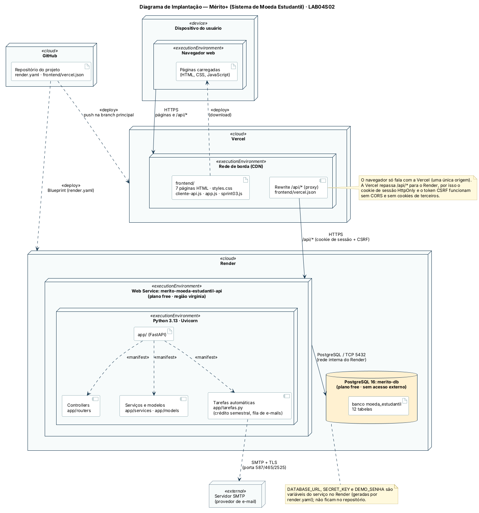
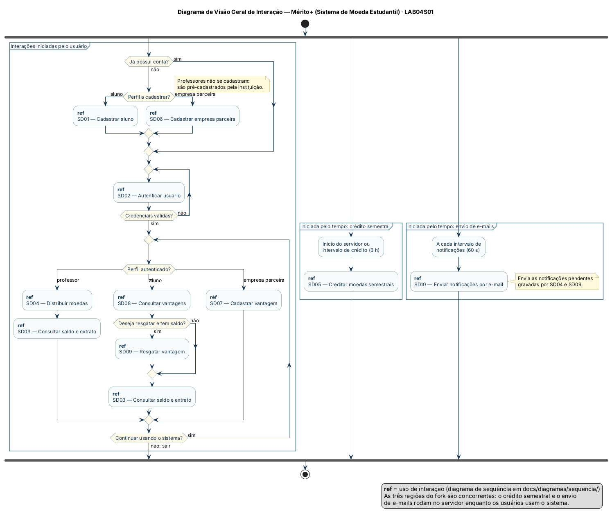

# LAB04S02 — Sistema de Moeda Estudantil | Aplicação publicada na nuvem

**PUC Minas · Engenharia de Software · Projeto de Software · Release 2 · 2º semestre de 2026**

## Acesso na nuvem

| | Endereço |
|---|---|
| **Aplicação** | https://merito-moeda-estudantil.vercel.app |
| API (Render) | https://merito-moeda-estudantil-api.onrender.com/api/saude |
| Documentação da API | https://merito-moeda-estudantil-api.onrender.com/docs |

Contas de demonstração na nuvem: `professor@demo.local`, `aluno.demo` e `empresa.demo`. A senha é gerada pelo Render (variável `DEMO_SENHA` do serviço) e entregue a quem for avaliar; ela **não** é a senha local. No plano gratuito, o primeiro acesso depois de um período parado leva cerca de 1 minuto.

## LAB04S02 — Implantação (item 4.5 do enunciado)

- **Diagrama de Implantação** (UML): [`docs/diagramas/implantacao.png`](docs/diagramas/implantacao.png), com fonte em `implantacao.puml`.
- **Aplicação implantada:**
  - interface na **Vercel** (`frontend/`, `frontend/vercel.json`);
  - API e banco PostgreSQL no **Render** (`render.yaml`).
- **Como foi implantado e como reproduzir:** [`docs/IMPLANTACAO.md`](docs/IMPLANTACAO.md).



## LAB04S01 — Diagramas de interação e casos de uso restantes (item 4.4)

- **Diagramas de Sequência** (um por caso de uso) e **Diagrama de Visão Geral de Interação**, em UML: `docs/diagramas/sequencia/` e `docs/diagramas/visao_geral_interacao.*`.
- **Casos de uso restantes**: o crédito semestral (UC05) e o envio de e-mails (UC12) passam a ser feitos automaticamente pelo servidor, sem operador.

Detalhes, mapa caso de uso → diagrama → código e como os diagramas se mantêm alinhados ao código: [`docs/LAB04S01_DIAGRAMAS_INTERACAO.md`](docs/LAB04S01_DIAGRAMAS_INTERACAO.md).



## Funcionalidades (acumuladas do LAB03S03)

- **Protótipo funcional**: FastAPI + SQLAlchemy (API) e páginas HTML + CSS + JavaScript (interface em `frontend/`). SQLite localmente; PostgreSQL na nuvem. Interface em português.
- **CRUD final de aluno e empresa parceira**: inclusão, consulta, edição, exclusão física quando permitida ou desativação com histórico; validação de CPF/CNPJ, instituição e perfis.
- **Autenticação e autorização**: sessão HTTPOnly, PBKDF2-SHA256 com salt, proteção CSRF, autorização por usuário e perfil.
- **Carteiras e extratos**: saldo de aluno/professor e histórico de crédito, distribuição e resgate.
- **Crédito semestral**: 1.000 moedas acumuláveis, uma vez por professor por semestre, creditadas automaticamente pelo servidor (LAB04S01).
- **Distribuição**: professor → aluno da instituição, motivo obrigatório, saldo positivo, débito/crédito e notificação gravados juntos.
- **Vantagens**: criação, edição, desativação e catálogo público com título, custo, foto e descrição.
- **Resgate**: validação de saldo, débito indivisível, cupom aleatório único e notificações para aluno e empresa.
- **Uso de cupom**: empresa dona da vantagem pode confirmar e baixar um cupom uma única vez.
- **Material acadêmico**: relatório final de 8 páginas, ER, arquitetura, fluxo transacional, slide deck de 20 páginas e roteiro de 20 minutos.
- **Testes**: 61 testes automatizados (11 do LAB03S03, 25 do LAB04S01 e 25 do LAB04S02), aprovados no SQLite e no PostgreSQL.

## 1. Requisitos

- Python 3.11 ou superior (recomendado 3.12/3.13) com `pip`.
- Windows 10/11 com PowerShell, ou macOS/Linux com shell.
- Internet na primeira instalação das dependências e para carregar imagens externas do catálogo (opcional).
- Sem necessidade de instalar SQL Server, MySQL ou docker.

## 2. Executar no Windows (mais simples)

Abra a pasta do projeto no PowerShell:

```powershell
.\iniciar_windows.ps1
```

O script cria `.venv`, instala dependências e inicia o servidor. Se o PowerShell bloquear scripts:

```powershell
powershell -ExecutionPolicy Bypass -File .\iniciar_windows.ps1
```

**Acesse** http://127.0.0.1:8000 (interface) ou http://127.0.0.1:8000/docs (API interativa). Localmente, o próprio FastAPI serve as páginas de `frontend/`, então um único comando sobe tudo.

## 3. Executar no Linux ou macOS

```bash
python3 -m venv .venv
source .venv/bin/activate
python -m pip install -r requirements.txt
python run.py
```

O banco SQLite é criado na primeira execução. Para ter aluno, empresa e vantagem fictícios prontos para a demonstração, execute `python -m scripts.preparar_demo` (seção 4).

## 4. Dados de demonstração

As credenciais abaixo são **somente para uso local**. Na nuvem a senha é outra (veja "Acesso na nuvem"), e a API se recusa a iniciar em produção com a senha local.

| Perfil | Login | Senha |
|---|---|---|
| Professor | `professor@demo.local` | `Demo@12345` |
| Aluno | `aluno.demo` | `Demo@12345` |
| Empresa | `empresa.demo` | `Demo@12345` |

Caso o banco tenha sido removido, execute na raiz do projeto antes de iniciar a aplicação:

```bash
python -m scripts.preparar_demo
```

O script é idempotente: ele cadastra apenas contas/benefícios ainda inexistentes e aplica o crédito de demonstração do semestre `2026/2` **uma única vez**. A vantagem inicial é “Desconto no lanche”, com custo de 150 moedas.

## 5. Roteiro rápido de demonstração

1. Login como **professor**; veja as 1.000 moedas no painel. Selecione o aluno `Estudante Exemplo`, informe `200` moedas e motivo `Participação no projeto`, e confirme. Observe o extrato e o saldo de 800.
2. Saia e entre como **aluno**; confirme 200 moedas e o recebimento no extrato. Abra **Vantagens** e resgate `Desconto no lanche` por 150 moedas. Seu saldo será 50 e aparecerá o cupom.
3. Entre como **empresa**; confira suas vantagens no painel. Copie o código de cupom gerado para a área de conferência e execute a utilização. Tentar utilizar novamente é rejeitado.
4. Abra o banco `moeda_estudantil.db` com um cliente SQLite ou utilize os endpoints de consulta para mostrar que saldos, lançamentos, resgate, cupom e notificações estão persistidos.

**Atenção:** se já houve transferências/resgates no mesmo banco, os números do exemplo serão diferentes. Para uma demonstração reprodutível, use um banco novo e execute o seed antes do teste.

## 6. Créditos automáticos por semestre

O backend não oferece uma rota pública que permita a um professor criar moedas. A concessão pertence à rotina administrativa; execute manualmente na avaliação ou agende no início de cada semestre:

```bash
python -m scripts.creditar_semestre 2026/2
python -m scripts.creditar_semestre 2026/2
```

A segunda execução não realiza novo crédito. Sem argumento, o script usa o semestre atual.

**Desde o LAB04S01, o crédito é automático:** o próprio servidor faz o papel de agendador (caso de uso UC05). Ao iniciar e a cada 6 horas, identifica o semestre atual (janeiro a junho: `AAAA/1`; julho a dezembro: `AAAA/2`) e credita os professores que ainda não receberam. Código em `app/tarefas.py`; desligue com `TAREFAS_AUTOMATICAS=0`.

## 7. Envio de e-mails: fila persistente + SMTP

Transações e resgates sempre gravam **notificações `pendente`** no banco; não enviamos e-mails automaticamente dentro do request para evitar duplicidade em caso de falha da rede. Para entregar e-mails reais, configurar variáveis no `.env` (ver `.env.example`):

```dotenv
SMTP_HOST=smtp.exemplo.com
SMTP_PORT=587
SMTP_USER=usuario@exemplo.com
SMTP_PASSWORD=senha-de-aplicativo
SMTP_FROM=usuario@exemplo.com
SMTP_STARTTLS=1
```

Depois, executar:

```bash
python -m scripts.processar_notificacoes
```

**Sem SMTP configurado, nenhuma mensagem é enviada**: o script avisa e mantém os registros pendentes. Dados de demo usam domínios `.local`, portanto os endereços fictícios não recebem e-mail real. Para testar envio de verdade, atualize os e-mails cadastrados para caixas de teste autorizadas e configure uma conta SMTP própria. O sistema limita as tentativas por notificação a cinco.

**Desde o LAB04S01, o envio é automático:** com o SMTP configurado, o servidor envia a fila a cada 60 segundos (caso de uso UC12, `app/services/notificacoes.py`). A porta 465 usa SSL; 587 ou 2525 usam STARTTLS. O script acima continua disponível para envio manual. **Na nuvem**, basta preencher as variáveis `SMTP_*` no painel do Render (`docs/IMPLANTACAO.md`).

## 8. Executar testes

```bash
python -m pytest -q
# Os mesmos testes no PostgreSQL (banco exclusivo para testes: as tabelas são recriadas):
TEST_DATABASE_URL=postgresql://usuario@localhost:5432/banco_de_teste python -m pytest -q
```

Os testes do LAB04S02 (`tests/test_implantacao.py`) verificam:

- configuração de produção;
- proxy da Vercel apontando para o serviço do Render;
- páginas e recursos estáticos;
- ausência de scripts bloqueados pela política de segurança;
- correspondência entre cada rota `/api` chamada pela interface e uma rota existente na API.

Os testes do LAB04S01 verificam:

- **Crédito automático:** semestre atual, crédito único, início e encerramento das tarefas com o servidor.
- **Fila de e-mails:** envio, novas tentativas e limite de cinco.
- **Diagramas × código:** cada função e rota citada nos diagramas de sequência existe no código (`tests/test_diagramas_interacao.py`).

Os testes do LAB03S03 verificam: criação e manutenção de cadastros, autenticação, privacidade, vínculo institucional, crédito idempotente, distribuição/rollback por saldo insuficiente, resgate, cupom único, autorização cruzada, desativação e fila de e-mail.

## 9. Estrutura do projeto

```text
moeda-estudantil/
├── app/
│   ├── main.py, config.py, database.py, models.py, schemas*.py, security.py
│   ├── tarefas.py          # Crédito semestral e envio de e-mails automáticos (LAB04S01)
│   ├── routers/            # Controllers FastAPI
│   ├── services/           # Regras do domínio e transações
│   └── repositories/       # Consultas dos CRUDs
├── frontend/               # View: páginas HTML + static/ (CSS e JS), publicada na Vercel (LAB04S02)
│   └── vercel.json         # Proxy /api para o Render e cabeçalhos de segurança
├── render.yaml             # Blueprint do Render: API + PostgreSQL (LAB04S02)
├── .python-version         # Python usado no Render
├── scripts/
│   ├── preparar_demo.py
│   ├── creditar_semestre.py
│   ├── processar_notificacoes.py
│   └── gerar_materiais_final.py
├── tests/                  # pytest
├── docs/
│   ├── IMPLANTACAO.md      # Publicação na Vercel e no Render (LAB04S02)
│   ├── LAB04S01_DIAGRAMAS_INTERACAO.md   # Diagramas de sequência e visão geral (LAB04S01)
│   ├── LAB03S03_Relatorio_Completo.pdf
│   ├── ARQUITETURA_PERSISTENCIA.md
│   ├── API_SPRINT03.md
│   ├── RASTREABILIDADE_FINAL.md
│   ├── esquema_sqlite.sql, esquema_postgresql.sql
│   └── diagramas/          # Implantação, sequência (sequencia/), visão geral de interação, ER, MVC e fluxo financeiro
├── apresentacao/
│   ├── LAB03S03_Apresentacao_Final_20min.pptx
│   ├── LAB03S03_Apresentacao_Final_20min.pdf
│   └── Roteiro_Apresentacao_20min.md
├── referencias/             # arquivos de origem e documentação da S02
├── iniciar_windows.ps1
├── requirements.txt
└── run.py
```

## 10. MVC e decisões técnicas

A camada **View** são as páginas de `frontend/` com `fetch` de JavaScript (até o LAB04S01, templates Jinja2). Na nuvem, ela é servida pela Vercel, que repassa `/api/*` para a API no Render. Os **Controllers** são os módulos em `app/routers`; validam os dados de entrada com Pydantic e as permissões no servidor. O **Model** está em `app/models.py`, `app/services/` e schemas; operações de moedas usam SQL condicional e commit transacional. A **persistência** utiliza SQLAlchemy 2.x (ORM) com SQLite localmente e PostgreSQL na nuvem, com checagem de FK e constraints. Detalhes e diagramas em `docs/ARQUITETURA_PERSISTENCIA.md`.

## 11. Limites importantes

O projeto é um **protótipo acadêmico**. A implantação pública usa planos gratuitos (limites em `docs/IMPLANTACAO.md`; o banco gratuito do Render expira 30 dias após a criação). Não inclui envio de e-mail operacional sem SMTP, migrações Alembic, antifraude, fila distribuída, upload binário de fotos, tratamento LGPD completo, limitação de taxa e integração com instituição real. A chave de sessão e a senha de demonstração padrão valem só localmente: em produção, a API exige valores próprios, gerados pelo Render.

## 12. Documentos e apresentação

- Implantação (LAB04S02): `docs/IMPLANTACAO.md` e `docs/diagramas/implantacao.*`.
- Diagramas de sequência e de visão geral de interação (LAB04S01): `docs/LAB04S01_DIAGRAMAS_INTERACAO.md`.
- Relatório de entrega do LAB03S03: `docs/LAB03S03_Relatorio_Completo.pdf`.
- PPTX editável e slides PDF: `apresentacao/LAB03S03_Apresentacao_Final_20min.*`.
- Script de fala em 20 minutos: `apresentacao/Roteiro_Apresentacao_20min.md`.
- Modelo ER: `docs/diagramas/modelo_er.*` (mantido da S02).
- Diagrama de arquitetura: `docs/diagramas/arquitetura_lab04.*` (LAB04S02) e `docs/diagramas/arquitetura_final.*` (LAB03S03).
- Fluxo de transações: `docs/diagramas/fluxo_transacoes.*`.
- API documentada: `docs/API_SPRINT03.md`, além do OpenAPI em `/docs`.

**Referência acadêmica:** `LABORATORIO_3_LAB_DESENVOLVIMENTO_DE_SOFTWARE`, seções 3 e 4.3; modelos e história da S01 e S02 fornecidos com o projeto.
