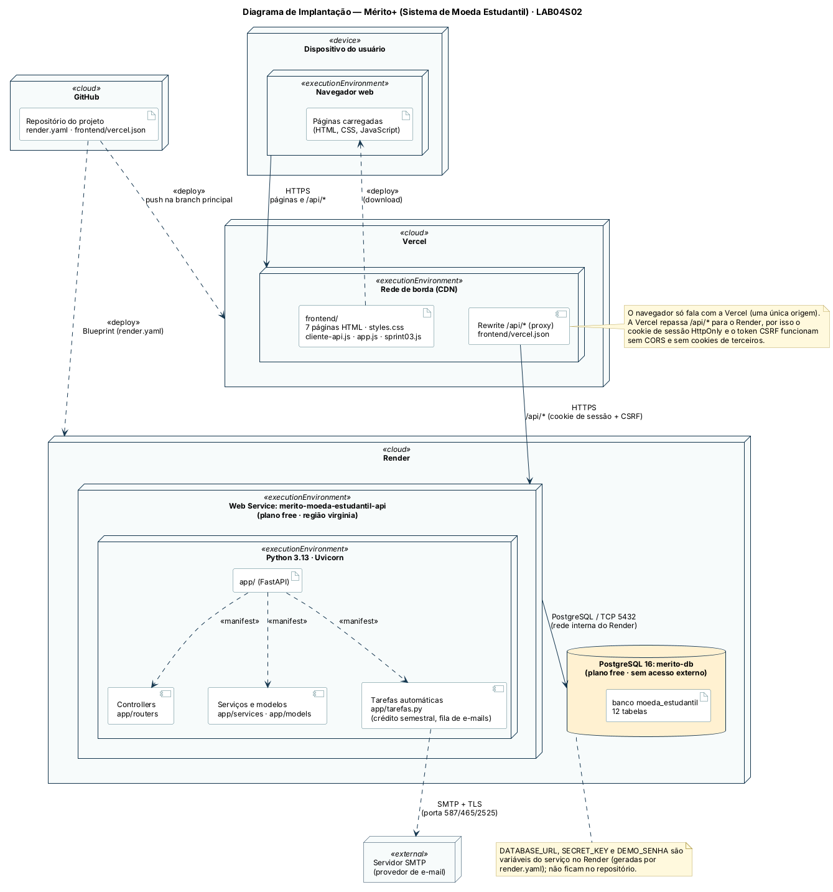

# Implantação na nuvem — LAB04S02

> **Enunciado (4.5 Lab04S02):** desenvolver o Diagrama de Implantação e implantar a aplicação na nuvem, preferencialmente na Vercel e no Render.

| Parte | Onde roda | Endereço |
|---|---|---|
| Interface (View) | Vercel | https://merito-moeda-estudantil.vercel.app |
| API (Controllers + Model) | Render, Web Service gratuito | https://merito-moeda-estudantil-api.onrender.com |
| Documentação interativa da API | Render | https://merito-moeda-estudantil-api.onrender.com/docs |
| Banco de dados | Render, PostgreSQL 16 gratuito | sem acesso externo (só a API acessa) |

> **Publicação de 11/11/2026:** o Render e a Vercel atribuíram exatamente esses endereços, e o fluxo pela Vercel foi conferido: páginas, proxy `/api/*`, sessão e cabeçalhos de segurança. O banco gratuito `merito-db` fica disponível até **11/12/2026**. Em uma nova publicação, os endereços dependem dos nomes disponíveis no momento; se mudarem, siga o passo 4 da seção "Como publicar".

## 1. Diagrama de implantação



Fonte editável em [`diagramas/implantacao.puml`](diagramas/implantacao.puml) (PlantUML), com exportações em PNG, SVG e PDF. A arquitetura MVC atualizada está em [`diagramas/arquitetura_lab04.png`](diagramas/arquitetura_lab04.png).

## 2. Como a interface e a API se comunicam

O navegador acessa **somente a Vercel**. As páginas chamam a API por caminhos relativos (`/api/...`), e a Vercel repassa esses caminhos para o Render (regra `rewrites` em [`frontend/vercel.json`](../frontend/vercel.json)):

```
Navegador ──HTTPS──► Vercel ─┬─ páginas, CSS e JS (frontend/)
                             └─ /api/* ──HTTPS──► Render (FastAPI) ──► PostgreSQL
```

**Por que usar o proxy da Vercel em vez de chamar o Render diretamente?** O login usa cookie de sessão HttpOnly e token CSRF. Se a página na Vercel chamasse o domínio do Render diretamente, o cookie seria de **terceiros**, que os navegadores bloqueiam ou restringem cada vez mais (o Safari, por padrão). Com o proxy, o navegador enxerga uma única origem: a segurança do Lab03 continua igual, sem CORS e sem afrouxar o `SameSite` do cookie.

## 3. O que mudou no código para a nuvem

| Arquivo | Mudança | Motivo |
|---|---|---|
| `frontend/` (novo) | As 7 páginas Jinja (até o LAB04S01) viraram HTML estático; `app/static` foi movido para `frontend/static`. | A Vercel serve arquivos estáticos. Os templates só usavam título e nome da página: todo o conteúdo já vinha do JavaScript via `fetch`. |
| `frontend/vercel.json` (novo) | URLs limpas (`/login` → `login.html`), proxy `/api/*` e cabeçalhos de segurança (CSP, `nosniff`). | Comunicação com a API e proteção contra injeção de scripts. |
| `frontend/static/js/cliente-api.js` (novo) | Cliente HTTP único, usado por `app.js` e `sprint03.js`. Repete consultas (GET) enquanto a API "acorda". | No plano gratuito, a API dorme após alguns minutos sem acesso e leva cerca de 1 minuto para voltar. |
| `app/config.py` | `AMBIENTE=producao`; conversão da URL do PostgreSQL; senha de demonstração vinda de `DEMO_SENHA`; validação que impede subir na nuvem com segredos de demonstração. | O README do Lab03 alertava que chave e senhas padrão não servem para hospedagem pública. |
| `app/database.py` | Pool de conexões adequado ao PostgreSQL. | Banco gerenciado encerra conexões ociosas. |
| `app/main.py` | `/api/saude` (verificação de saúde do Render), `Cache-Control: no-store` na API e, só localmente, servir `frontend/`. | Operação na nuvem. |
| `app/seed.py`, `scripts/preparar_demo.py` | Demo completa reutilizável (`popular_demo_completo`) com a senha de `DEMO_SENHA`. | A mesma demonstração funciona localmente e na nuvem. |
| `render.yaml` (novo) | Blueprint: banco + API, variáveis e segredos gerados pelo Render. | Infraestrutura reproduzível e versionada. |
| `.python-version`, `requirements.txt` | Python 3.13; driver `psycopg`; Jinja2 removido. | Versão igual à usada nos testes. |
| `tests/test_implantacao.py` (novo) | 25 testes de configuração, proxy, páginas e alinhamento frontend × API. | Ver seção 7. |

Regras de negócio, modelos, controllers e telas **não mudaram**: os testes do LAB03S03 e do LAB04S01 continuam passando, também no PostgreSQL.

O crédito semestral e o envio da fila de e-mails já eram automáticos desde o LAB04S01 (`app/tarefas.py`). Isso é o que permite operar no plano gratuito do Render, que não tem agendador (cron) gratuito.

## 4. Como publicar (passo a passo reproduzível)

Pré-requisitos: o código no repositório do grupo no GitHub e contas gratuitas no [Render](https://render.com) e na [Vercel](https://vercel.com) (é possível entrar com a conta do GitHub).

### Passo 1 — API e banco no Render (Blueprint)

1. No Render: **New → Blueprint** e escolha o repositório do grupo (autorize o acesso do Render ao repositório, se pedido).
2. O Render lê o `render.yaml` e mostra o que será criado: o banco `merito-db` e o serviço `merito-moeda-estudantil-api`.
3. Ele pede os valores das variáveis `SMTP_*`. Para enviar e-mails de verdade, preencha-as (seção 6); caso contrário, deixe em branco.
4. Clique em **Apply** (ou **Deploy Blueprint**). A primeira publicação leva alguns minutos.
5. Confira: `https://<serviço>.onrender.com/api/saude` deve responder `{"status":"ok","ambiente":"producao"}`.

Na primeira inicialização, a API cria as tabelas, cadastra as instituições, as contas de demonstração e uma vantagem, e credita as 1.000 moedas do semestre atual ao professor.

### Passo 2 — Interface na Vercel

1. Na Vercel: **Add New → Project** e importe o repositório do grupo.
2. Em **Root Directory**, escolha `frontend`.
3. **Framework Preset:** `Other`. Deixe *Build Command* e *Output Directory* vazios (não há etapa de build).
4. Clique em **Deploy**.

### Passo 3 — Teste

Abra o endereço da Vercel e entre como professor (seção 5). O primeiro acesso depois de um tempo parado pode levar cerca de 1 minuto; a tela avisa "Conectando ao servidor" e continua sozinha.

### Passo 4 — Se o endereço do Render for diferente

O destino do proxy fica em `frontend/vercel.json`. Se o Render criar o serviço com outro endereço (por exemplo `merito-moeda-estudantil-api-x1y2.onrender.com`), troque o domínio na regra `rewrites`, faça commit e push. O teste `test_vercel_repassa_api_para_o_servico_do_render` confere esse vínculo com o nome do serviço no `render.yaml`. Se mudar o nome do serviço, mude nos dois arquivos.

### Atualizações

Cada push na branch principal republica automaticamente: a Vercel atualiza a interface e o Render atualiza a API. A API só é republicada quando mudam `app/`, `scripts/`, `requirements.txt`, `render.yaml` ou `.python-version` (`buildFilter` no `render.yaml`).

## 5. Contas de demonstração na nuvem

| Perfil | Login |
|---|---|
| Professor | `professor@demo.local` |
| Aluno | `aluno.demo` |
| Empresa | `empresa.demo` |

A senha **não** é a `Demo@12345` do ambiente local. Ela é gerada pelo Render ao criar o serviço: no painel do serviço, **Environment → DEMO_SENHA**. Compartilhe-a só com quem vai avaliar. Alunos e empresas também podem se cadastrar pela própria interface; professores, conforme o enunciado, são apenas pré-cadastrados.

## 6. Variáveis de ambiente (Render)

| Variável | Valor | Observação |
|---|---|---|
| `AMBIENTE` | `producao` | Ativa as validações de segurança e as tarefas automáticas. |
| `DATABASE_URL` | preenchida pelo Render | URL interna do `merito-db`. |
| `SECRET_KEY` | gerada pelo Render | Assina o cookie de sessão. |
| `DEMO_SENHA` | gerada pelo Render | Senha das contas de demonstração. |
| `SEED_DEMO_PROFESSOR` / `SEED_DEMO_COMPLETO` | `1` / `1` | Cria professor, aluno, empresa e vantagem de demonstração (só se ainda não existirem). |
| `TAREFAS_AUTOMATICAS` | `1` | Crédito semestral e envio da fila de e-mails dentro do servidor. |
| `SMTP_HOST`, `SMTP_PORT`, `SMTP_USER`, `SMTP_PASSWORD`, `SMTP_FROM` | opcionais | Sem `SMTP_HOST`, as notificações ficam pendentes no banco. |

**E-mail (opcional):** porta 465 usa SSL; 587 ou 2525 usam STARTTLS. Com Gmail, use uma **senha de app** (nunca a senha da conta). Se os logs do Render mostrarem falha de conexão com o servidor SMTP, o provedor de hospedagem pode estar bloqueando a porta; nesse caso, use um provedor de e-mail transacional que aceite a porta 2525. **Nunca** coloque essas senhas no repositório ou em arquivos de entrega: elas ficam só no painel do Render.

## 7. Testes

```bash
python -m pytest -q                                   # 61 testes, SQLite em memória
TEST_DATABASE_URL=postgresql://usuario@localhost:5432/banco_de_teste python -m pytest -q   # os mesmos 61, no PostgreSQL
```

> Com `TEST_DATABASE_URL`, todas as tabelas do banco informado são apagadas e recriadas. Use um banco exclusivo para testes.

Além dos testes automatizados, a configuração foi verificada simulando a nuvem: API em `AMBIENTE=producao` sobre PostgreSQL 16 e interface servida por um simulador que aplica o mesmo `vercel.json` (proxy, URLs limpas e CSP). O fluxo completo passou no navegador:

- professor recebe as 1.000 moedas automáticas e distribui 200;
- aluno resgata uma vantagem e recebe o cupom;
- empresa baixa o cupom uma única vez;
- novo aluno se cadastra;
- a página se recupera sozinha quando a API está "acordando".

## 8. Limites do plano gratuito

Confira as condições atuais na página de preços de cada serviço: elas podem mudar.

- **API do Render:** "dorme" após cerca de 15 minutos sem acessos. O primeiro acesso seguinte leva em torno de 1 minuto.
- **PostgreSQL gratuito do Render:** **expira 30 dias após a criação**. Para a avaliação, crie (ou recrie) o Blueprint perto da data da apresentação, ou migre para um plano pago.
- **Um banco gratuito por conta:** se já houver outro banco gratuito na conta, a criação do `merito-db` falha.

## 9. Solução de problemas

| Sintoma | Causa provável e solução |
|---|---|
| Deploy do Render falha com `Configuração inválida para produção` | Faltam `SECRET_KEY` ou `DEMO_SENHA`, ou `DATABASE_URL` não aponta para o PostgreSQL. Recrie pelo Blueprint, que gera esses valores. |
| Interface abre, mas o login responde "Sessão de segurança inválida" | O proxy não está chegando à API: confira o domínio em `frontend/vercel.json` (passo 4) e acesse `/api/saude` pelo endereço da Vercel. |
| `/api/...` na Vercel responde 404 | O projeto da Vercel não está com **Root Directory** = `frontend`, então o `vercel.json` não foi lido. |
| Primeira página demora cerca de 1 minuto | Normal no plano gratuito (a API estava dormindo). |
| Notificações ficam como `pendente` | `SMTP_HOST` não configurado (comportamento esperado do Lab03), ou falha de envio: veja os logs do serviço no Render. |
