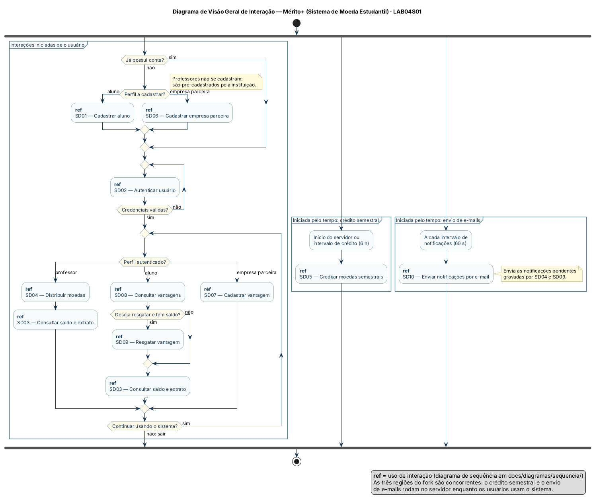

# LAB04S01 — Diagramas de interação e casos de uso restantes

> **Enunciado (4.4 Lab04S01):** desenvolver os Diagramas de Sequência do projeto e o Diagrama de Visão Geral de Interação (nos padrões UML) e implementar os casos de uso restantes, ou seja, os que não foram desenvolvidos na Release 1.

## 1. Casos de uso restantes

A Release 1 (LAB03S03) implementou todos os casos de uso do catálogo da LAB03S01, exceto dois, que ainda dependiam de um operador rodando scripts à mão, como registrava a própria matriz de rastreabilidade:

| Caso de uso | Situação no LAB03S03 | O que o LAB04S01 implementou |
|---|---|---|
| **UC05 — Creditar moedas semestrais** (ator: agendador) | Script `scripts/creditar_semestre.py`, com o semestre digitado à mão e um agendador externo a configurar | O próprio servidor faz o papel de agendador (`app/tarefas.py`): ao iniciar e a cada 6 horas, identifica o semestre atual e credita 1.000 moedas a cada professor ativo. Continua idempotente (no máximo um crédito por professor e semestre, garantido pelo banco). |
| **UC12 — Enviar notificações por e-mail** | Notificações gravadas na fila (`notificacoes`), mas enviadas só ao rodar `scripts/processar_notificacoes.py` | O servidor envia a fila a cada 60 segundos, se o SMTP estiver configurado (`app/services/notificacoes.py`). O envio fica atrás da interface `EnviadorEmail` (Indireção e Variações Protegidas, GRASP) e une os dois scripts SMTP do LAB03 (STARTTLS e SSL). |

Os scripts manuais continuam funcionando e passaram a chamar os mesmos serviços. As tarefas automáticas podem ser desligadas com `TAREFAS_AUTOMATICAS=0`.

**Verificação:** além dos testes automatizados, o fluxo foi executado com um servidor SMTP local. O servidor iniciou e creditou o professor; uma distribuição gerou um e-mail e um resgate gerou outros dois, para o aluno e para a empresa. Os três foram entregues pela tarefa automática no ciclo seguinte (intervalo reduzido para 2 segundos no teste; o padrão é 60 segundos), sem rodar nenhum script.

## 2. Diagramas de sequência

Fontes em `docs/diagramas/sequencia/*.puml` (PlantUML), com exportações em PNG e SVG. Cada participante indica o arquivo do código que o implementa, e cada mensagem usa o nome real da função ou da rota HTTP.

| Diagrama | Caso de uso | Histórias | Ponto de entrada no código |
|---|---|---|---|
| [SD01 — Cadastrar aluno](diagramas/sequencia/sd01_cadastrar_aluno.png) | UC01 | HU01 | `POST /api/alunos` → `services/alunos.criar` |
| [SD02 — Autenticar usuário](diagramas/sequencia/sd02_autenticar_usuario.png) | UC02 | HU02, HU03 | `POST /api/auth/login` → `security.verificar_senha` |
| [SD03 — Consultar saldo e extrato](diagramas/sequencia/sd03_consultar_extrato.png) | UC03 | HU09, HU10 | `GET /api/extrato` → `services/financeiro.extrato` |
| [SD04 — Distribuir moedas](diagramas/sequencia/sd04_distribuir_moedas.png) | UC04 (+ UC10, UC12, UC13) | HU06, HU07 | `POST /api/distribuicoes` → `services/financeiro.distribuir` |
| [SD05 — Creditar moedas semestrais](diagramas/sequencia/sd05_creditar_moedas_semestrais.png) | UC05 | HU05 | `tarefas.executar_periodicamente` → `services/financeiro.creditos_semestre` |
| [SD06 — Cadastrar empresa parceira](diagramas/sequencia/sd06_cadastrar_empresa.png) | UC06 | HU04 | `POST /api/empresas` → `services/empresas.criar` |
| [SD07 — Cadastrar vantagem](diagramas/sequencia/sd07_cadastrar_vantagem.png) | UC07 | HU11 | `POST /api/vantagens` → `routers/financeiro.criar_vantagem` |
| [SD08 — Consultar vantagens](diagramas/sequencia/sd08_consultar_vantagens.png) | UC08 | HU12 | `GET /api/vantagens` |
| [SD09 — Resgatar vantagem](diagramas/sequencia/sd09_resgatar_vantagem.png) | UC09 (+ UC10, UC11, UC12, UC13) | HU13, HU14 | `POST /api/resgates` → `services/financeiro.resgatar` |
| [SD10 — Enviar notificações por e-mail](diagramas/sequencia/sd10_enviar_notificacoes.png) | UC12 | HU08, HU14 | `tarefas.executar_periodicamente` → `services/notificacoes.enviar_pendentes` |

Os casos de uso internos (UC10 Registrar movimentação, UC11 Gerar cupom, UC13 Validar saldo) aparecem dentro de SD04 e SD09, onde são incluídos (`«include»` no diagrama de casos de uso). HU15 (integridade das transações) e HU16 (ações restritas) também são visíveis nesses diagramas: commit/rollback únicos e as chamadas `exigir_csrf`, `usuario_atual` e `exigir_perfil`.

**Notação:** `actor` (ator), `boundary` (View), `control` (controllers e tarefas), `participant` (serviços, repositórios e segurança), `database` (banco). Os blocos `alt`, `opt` e `loop` seguem os fluxos alternativos das especificações da LAB03S01.

## 3. Diagrama de visão geral de interação



Fonte em `docs/diagramas/visao_geral_interacao.puml`. Cada nó **ref** é um uso de interação que aponta para um diagrama de sequência. Os nós de decisão mostram o encadeamento:

- cadastro (só para quem ainda não tem conta);
- autenticação;
- interações de cada perfil;
- possibilidade de continuar usando o sistema.

O `fork` mostra que o crédito semestral (SD05) e o envio de e-mails (SD10) rodam no servidor ao mesmo tempo que as interações dos usuários.

## 4. Como os diagramas se mantêm alinhados ao código

O teste `tests/test_diagramas_interacao.py` lê os arquivos `.puml` e verifica:

- se cada arquivo de código citado nos participantes existe;
- se cada função chamada (por exemplo, `distribuir(...)` no participante `app/services/financeiro.py`) existe nesse arquivo;
- se cada rota HTTP (`POST /api/distribuicoes`) existe na API com esse método;
- se há um diagrama por caso de uso e se a visão geral referencia todos eles.

Se uma mudança no código quebrar o diagrama, o teste falha e mostra o que divergiu.

Para gerar novamente as imagens (Java + PlantUML):

```bash
cd docs/diagramas
java -jar plantuml.jar -charset UTF-8 -tpng -tsvg sequencia/sd*.puml visao_geral_interacao.puml
```
